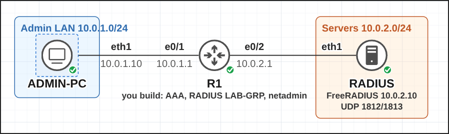
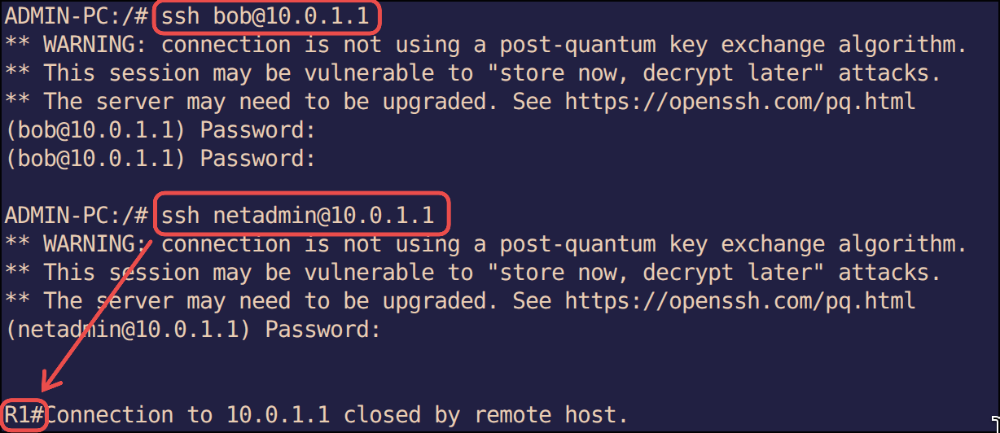
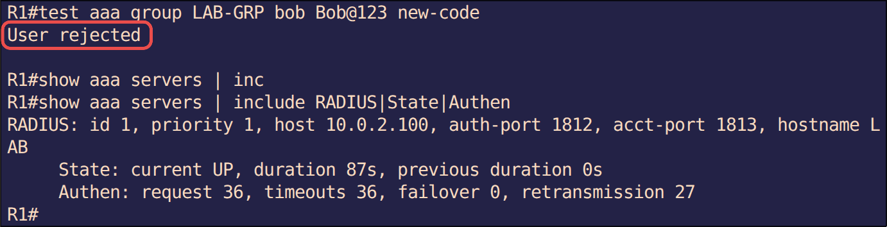
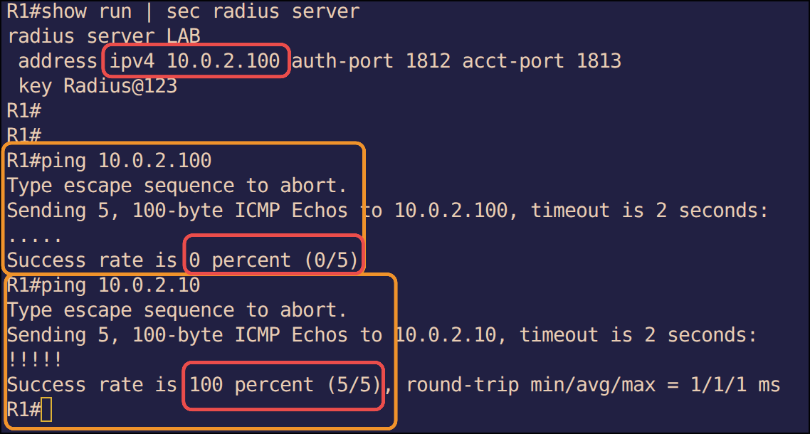
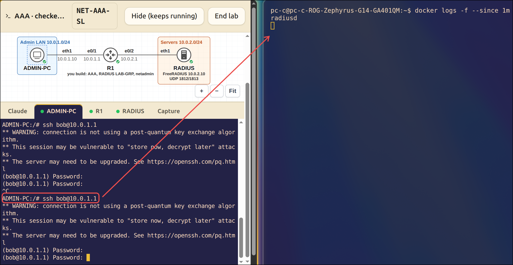
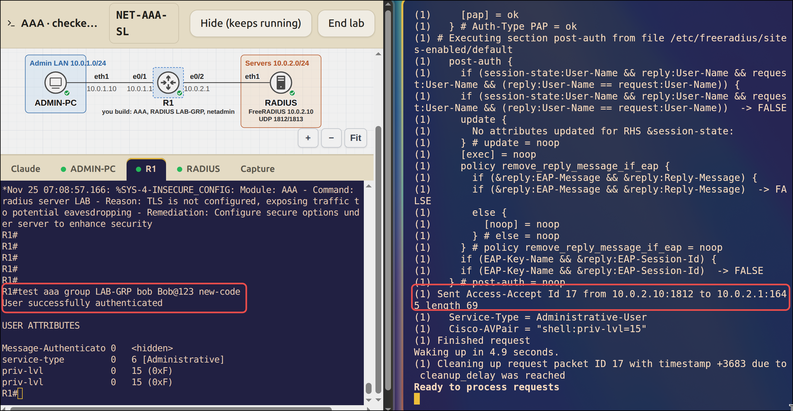
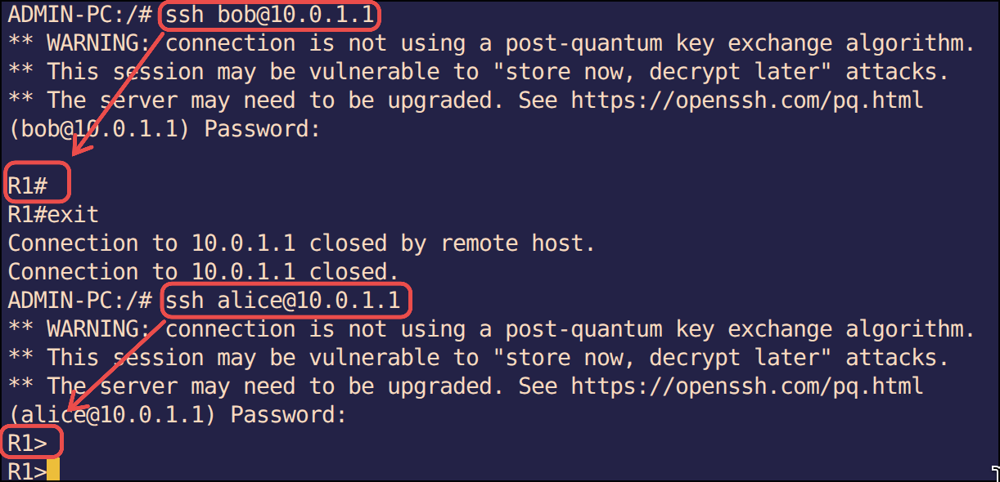
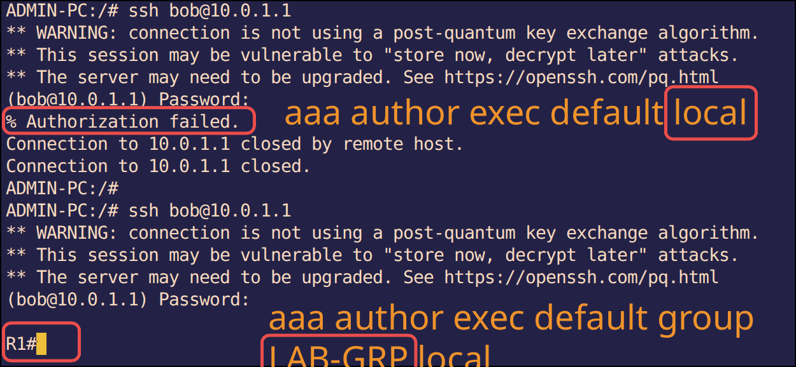

# Lab 4.7: AAA Method Lists with RADIUS and Local Backup (Wrong RADIUS Server Address)

> **Topology:** [`net-aaa.clab.yml`](./net-aaa.clab.yml) · R1 startup config [`r1.partial.cfg`](./r1.partial.cfg) · FreeRADIUS [`clients.conf`](./clients.conf), [`authorize`](./authorize)
> **Platform:** containerlab · Cisco IOL `17.18.2` · 1 router (R1) · Alpine admin PC · FreeRADIUS 3 container
> **Key takeaway:** A RADIUS server that never answers looks like a bad password to the user, but it is slow. The `local` method is only tried after the timeout, and `test aaa` just says "User rejected". The timeout counter in `show aaa servers` and an empty server log are what show it.

---

## Topology & Addressing

| Device | Interface | Address | Role |
| :--- | :--- | :--- | :--- |
| **ADMIN-PC** | `eth1` | 10.0.1.10/24 | SSH client |
| **R1** | `e0/1` | 10.0.1.1/24 | SSH target, RADIUS client (NAS) |
| **R1** | `e0/2` | 10.0.2.1/24 | Link to the server LAN |
| **RADIUS** | `eth1` | 10.0.2.10/24 | FreeRADIUS on UDP 1812/1813, secret `Radius@123` |

| User | Where | Password | Lands at |
| :--- | :--- | :--- | :---: |
| `bob` | RADIUS | `Bob@123` | `R1#` (`cisco-avpair = "shell:priv-lvl=15"`) |
| `alice` | RADIUS | `Alice@123` | `R1>` |
| `netadmin` | R1 local | `Net@123` | `R1#` (backup when RADIUS is down) |

### Working AAA config on R1

~~~
aaa new-model
aaa authentication login CON-OPEN none
aaa authentication login default group LAB-GRP local
aaa authorization exec default group LAB-GRP local
username netadmin privilege 15 secret Net@123
radius server LAB
 address ipv4 10.0.2.10 auth-port 1812 acct-port 1813
 key Radius@123
aaa group server radius LAB-GRP
 server name LAB
line con 0
 login authentication CON-OPEN
~~~

- `CON-OPEN` keeps the console open, so a broken default list can't lock me out.
- The vty lines don't name a list, so SSH uses `default`: RADIUS first, local only if RADIUS doesn't answer.
- Exec authorization gives the privilege level. Without it, bob passes the password check but lands at `R1>`.

---

## Fault-Injection (Break-It)

A colleague had already added the RADIUS server and the server group. I finished the rest (console list, netadmin, login and exec lists), but one line in their part was wrong.

### Symptom
`bob` can't SSH into R1. The password prompt hangs for about 20 seconds, then he is refused. `netadmin` still gets in, but only after the same wait.

~~~
ADMIN-PC$ ssh bob@10.0.1.1
ADMIN-PC$ ssh netadmin@10.0.1.1
~~~

### Diagnosis

1. **Is it slow because of no reply?** Yes. A server that receives the request answers at once, even for a wrong password. A 20 second wait and then a local login means R1 timed out on RADIUS and moved to the next method.

2. **What does R1 say?** `test aaa` only says `User rejected`, which looks like a wrong password. `show aaa servers` tells the real story: every request timed out, and the host is `10.0.2.100`.
   ~~~
   R1# test aaa group LAB-GRP bob Bob@123 new-code
   R1# show aaa servers | include RADIUS|State|Authen
   ~~~
   

3. **Is that the right server?** The server is at `10.0.2.10`. `10.0.2.100` doesn't answer a ping, and `10.0.2.10` does.
   ~~~
   R1# show running-config | section ^radius server
   R1# ping 10.0.2.100
   R1# ping 10.0.2.10
   ~~~
   

4. **Did anything reach the server?** No. The FreeRADIUS log shows no `Access-Request` from 10.0.2.1 during the logins.
   ~~~
   $ docker logs -f radiusd
   ~~~
   

> **Why does `show aaa servers` still say UP?** No dead time is set, so IOS marks the server up again right away. The `timeouts` counter going up with the `request` counter is the better sign.

### Fix
Point the server at the right address:
~~~
R1(config)# radius server LAB
R1(config-radius-server)# address ipv4 10.0.2.10 auth-port 1812 acct-port 1813
~~~

### Verification

| Test | Expected |
| :--- | :---: |
| `R1# test aaa group LAB-GRP bob Bob@123 new-code` | `User successfully authenticated` |
| `R1# show aaa servers` | host `10.0.2.10`, `Response: accept` > 0 |
| `docker logs radiusd` | `Sent Access-Accept ... to 10.0.2.1` |
| `ssh bob@10.0.1.1` | Lands at `R1#` right away |
| `ssh alice@10.0.1.1` | Lands at `R1>` |
| `ssh netadmin@10.0.1.1` | Refused at once: RADIUS sends `Access-Reject` |

> **Note:** netadmin is the backup for when RADIUS is down. While RADIUS answers, a reject is final and `local` is never tried.

---

## Second Fault: Authorization Failed

While RADIUS works, I changed only the exec list to `aaa authorization exec default local`. bob's password is accepted, then R1 prints `% Authorization failed` and drops him. `test aaa` still says success, because it only tests authentication.

bob only exists on the RADIUS server, so looking up his privilege in the local database fails. Fix: `aaa authorization exec default group LAB-GRP local`.

| Message | Which list |
| :--- | :--- |
| `% Authentication failed` / password refused | Login list (`aaa authentication login`) |
| `% Authorization failed` | Exec list (`aaa authorization exec`) |

---

## Troubleshooting Toolbox (IOS)

| Command | What it shows |
| :--- | :--- |
| `show running-config \| include ^aaa` | The login and exec method lists |
| `show aaa servers` | Server address, ports, request / timeout / accept counters |
| `test aaa group LAB-GRP bob Bob@123 new-code` | One RADIUS login test without SSH (authentication only) |
| `debug radius` / `undebug all` | Each Access-Request, retransmits and the reply (or timeout) |
| `docker logs -f radiusd` | What the server received and what it sent back |
