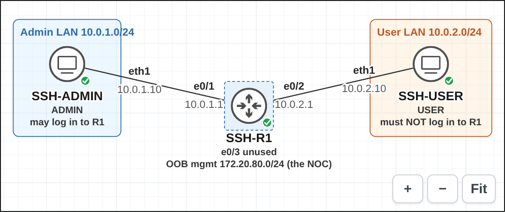
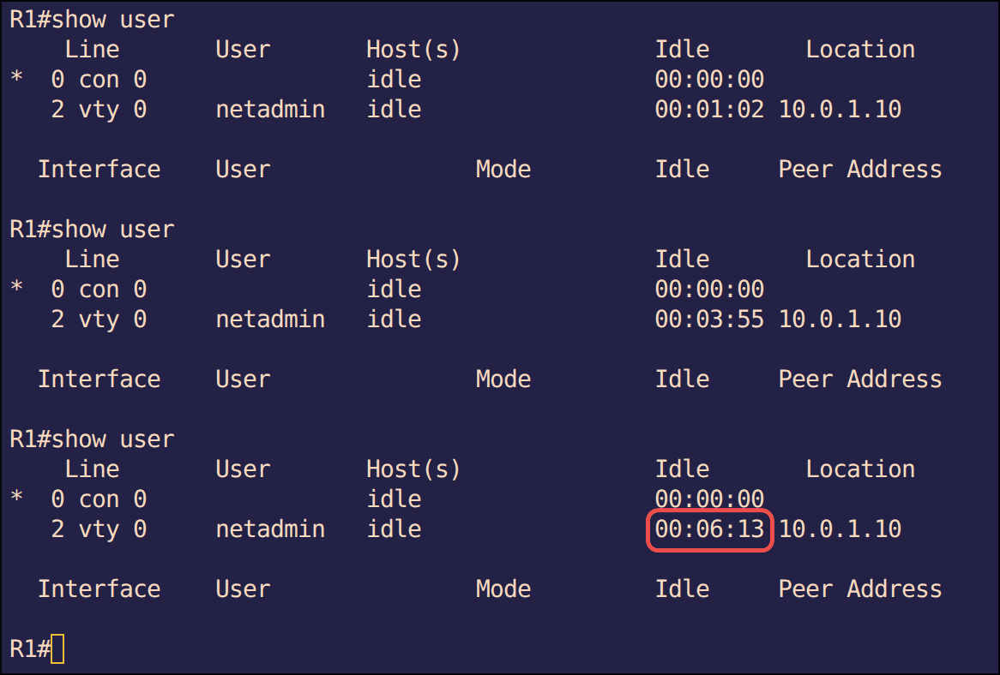
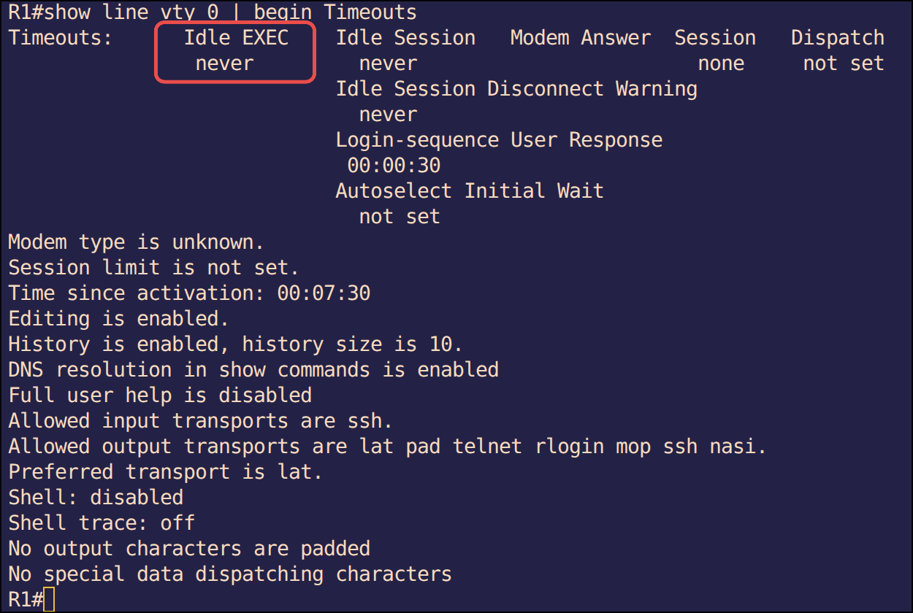
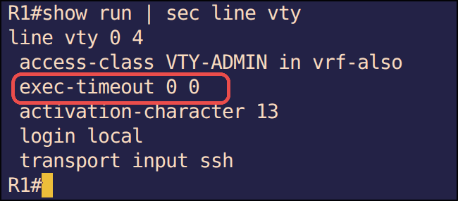
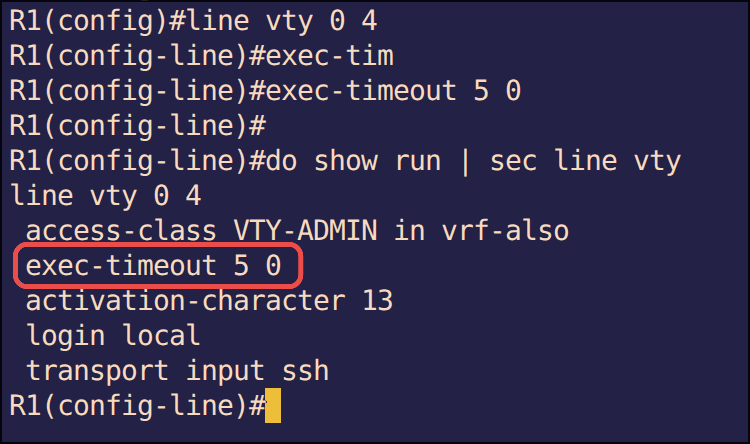
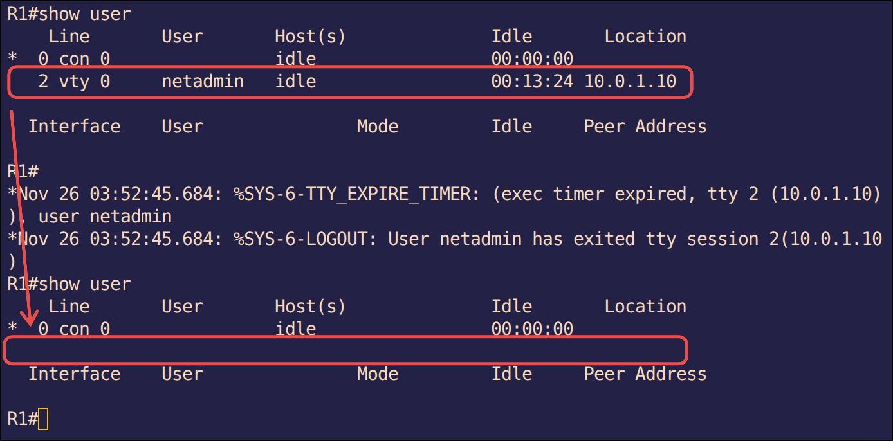
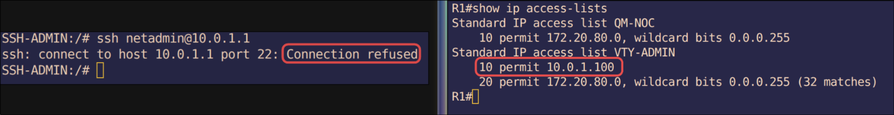

# Lab 4.8: SSH and Device Hardening (Idle Sessions Never Close)

> **Topology:** [`net-ssh.clab.yml`](./net-ssh.clab.yml) · R1 startup config [`r1.partial.cfg`](./r1.partial.cfg)
> **Platform:** containerlab · Cisco IOL `17.18.2` · 1 router (R1) · 2 Alpine PCs (ADMIN, USER)
> **Key takeaway:** A hardening mistake doesn't always break anything. With `exec-timeout 0 0` every login still works, but a forgotten SSH session stays logged in forever. Only comparing `show users` and `show line` against the standard finds it.
> *All passwords in this lab are lab-only examples.*

---

## Topology & Addressing

| Device | Interface | Address | Role |
| :--- | :--- | :--- | :--- |
| **ADMIN** | `eth1` | 10.0.1.10/24 | Admin PC, may log in to R1 |
| **R1** | `e0/1` | 10.0.1.1/24 | Admin LAN |
| **R1** | `e0/2` | 10.0.2.1/24 | User LAN |
| **R1** | `e0/3` | — | Unused, shut down |
| **R1** | `e0/0` | 172.20.80.11/24 | Out-of-band management (the NOC), management VRF |
| **USER** | `eth1` | 10.0.2.10/24 | Normal user, must NOT log in to R1 |

| User | Password | Lands at |
| :--- | :--- | :---: |
| `netadmin` | `Net@Admin123` | `R1#` |
| `support` | `Support@123` | `R1#` |

### Hardening standard on R1

~~~
! passwords
username netadmin privilege 15 secret Net@Admin123
username support privilege 15 secret Support@123
enable secret Ena@Secret1
service password-encryption
! SSH only, admin + NOC only
crypto key generate rsa modulus 3072 label SSH-KEY
ip ssh rsa keypair-name SSH-KEY
ip access-list standard VTY-ADMIN
 permit host 10.0.1.10
 permit 172.20.80.0 0.0.0.255
line vty 0 4
 transport input ssh
 access-class VTY-ADMIN in vrf-also
 exec-timeout 5 0
 login local
banner motd ^Authorized access only. All logins are logged.^
! brute-force protection
ip access-list standard QM-NOC
 permit 172.20.80.0 0.0.0.255
login quiet-mode access-class QM-NOC vrf-also
login block-for 120 attempts 3 within 60
login on-failure log
! attack surface
no ip http server
no ip http secure-server
interface Ethernet0/2
 no cdp enable
interface Ethernet0/3
 shutdown
~~~

- Generate the key before `ip ssh rsa keypair-name`. Pointing SSH at a key that doesn't exist turns the SSH server off.
- `vrf-also` matters on both ACLs. The NOC comes in on the management VRF, and without it the access-class refuses every VRF login, even ones the ACL permits.
- `QM-NOC` keeps the NOC able to log in during quiet mode, so someone failing logins on purpose can't lock the admins out.

---

## Fault-Injection (Break-It)

A colleague hardened R1 to the standard above, but one line was wrong. Every check I could think of passed at first: Telnet refused, SSH from ADMIN fine, USER refused, HTTP off.

### Symptom
I logged in from ADMIN and left the window open. More than 5 minutes later the session is still there, and `show users` on R1 shows it idle past the 5-minute limit.

~~~
ADMIN$ ssh netadmin@10.0.1.1
R1# show users
~~~

### Diagnosis

1. **Is my first guess right?** I thought the ACL was wrong, but ADMIN gets in, USER is refused and the NOC can log in, so the access-class is fine. The problem is something that doesn't block anyone.

2. **What timeout does the line really have?** `show line` shows the idle EXEC timeout as `never`.
   ~~~
   R1# show line vty 0 | begin Timeouts
   ~~~
   

3. **Where does `never` come from?** The vty config has `exec-timeout 0 0`. `0 0` doesn't mean "close at once", it means "never close".
   ~~~
   R1# show running-config | section ^line vty
   ~~~
   

> **Why it matters:** a session that never times out stays logged in at privilege 15. Anyone who sits down at that PC, or takes over the SSH client, gets R1 without a password. The default is 10 minutes, and the standard says 5.

### Fix
~~~
R1(config)# line vty 0 4
R1(config-line)# exec-timeout 5 0
~~~

### Verification

| Test | Expected |
| :--- | :---: |
| `R1# show running-config \| section ^line vty` | `exec-timeout 5 0` |
| `R1# show line vty 0 \| begin Timeouts` | Idle EXEC `00:05:00` |
| ADMIN session left idle for 5 minutes | `Connection to 10.0.1.1 closed by remote host.` |
| R1 log at the same moment | `%SYS-6-TTY_EXPIRE_TIMER: (exec timer expired, tty 2 (10.0.1.10))` then `%SYS-6-LOGOUT` |
| `R1# show users` | The idle netadmin session from 10.0.1.10 is gone |

> **Note:** the new timeout also applies to sessions that are already open. I didn't have to log out and back in to test it.

---

## Second Fault: Admin Refused After an ACL Clean-Up

A colleague cleaned up the ACLs, and since then ADMIN gets `Connection refused` before any password prompt. The NOC can still log in.

"Refused" before the prompt means the access-class, not the password. `show ip access-lists VTY-ADMIN` showed entry 10 was `permit 10.0.1.100`, not `10.0.1.10`, and its counter didn't move when ADMIN tried. Only the NOC entry was matching.

Fix in place, without opening R1 to anyone else:
~~~
R1(config)# ip access-list standard VTY-ADMIN
R1(config-std-nacl)# no 10
R1(config-std-nacl)# 10 permit host 10.0.1.10
~~~

| Message | Where to look |
| :--- | :--- |
| `Connection refused` (no password prompt) | access-class, `transport input`, or quiet mode |
| `Permission denied` (after the prompt) | Username or password |

---

## Troubleshooting Toolbox (IOS)

| Command | What it shows |
| :--- | :--- |
| `show users` | Who is logged in, from where, and how long each session has been idle |
| `show line vty 0 \| begin Timeouts` | The idle EXEC timeout the line really uses |
| `show running-config \| section ^line vty` | transport, access-class, exec-timeout on the vty lines |
| `show ip access-lists VTY-ADMIN` | Which hosts the vty ACL permits and the match counters |
| `show login` | block-for settings, failure count, Normal-Mode or Quiet-Mode |
| `show ip ssh` | SSH on or off, version 2.0 |
| `clear line vty N` | Kicks one session off without waiting for the timeout |
