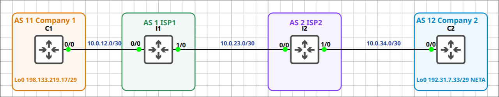
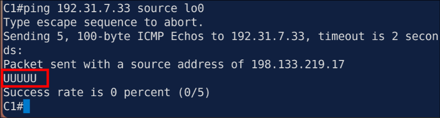
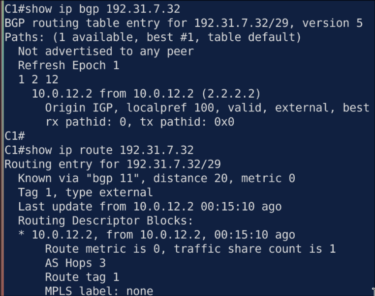
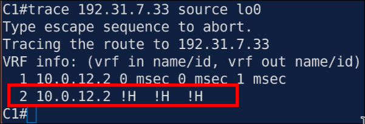
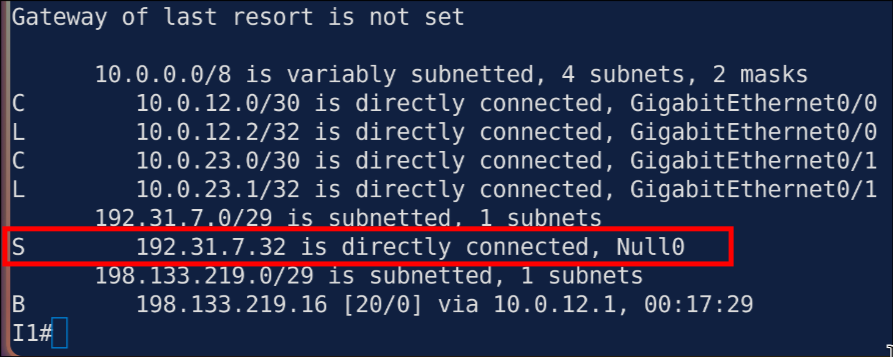
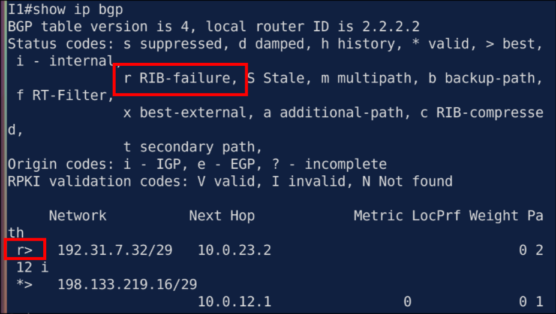
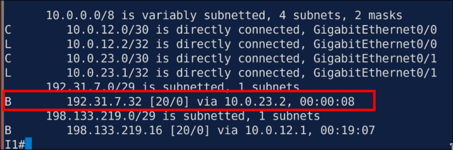
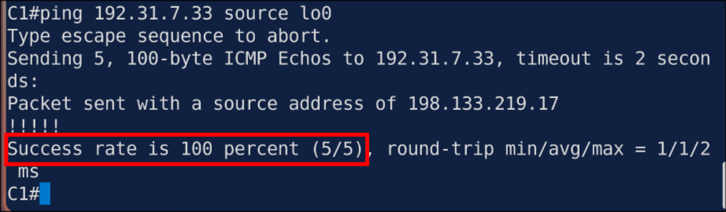

# Lab 1.1: BGP Tables and Administrative Distance

> **GNS3 Project:** [`ENARSI Module 1 - BGP Fundamentals | Lab 1 - BGP Tables and AD.gns3`](./ENARSI%20Module%201%20-%20BGP%20Fundamentals%20%7C%20Lab%201%20-%20BGP%20Tables%20and%20AD.gns3)
> **Platform:** GNS3 3.1 · Cisco IOSv `15.9(3)M12` · 4 routers (C1, I1, I2, C2)
> **Key takeaway:** A route can be the best path (`>`) in the BGP table and still not be used. The routing table takes the route with the lowest AD, so a static route (AD 1) beats eBGP (AD 20).

---

## Topology & Addressing

| Device | AS | Interface | Address | Role |
| :--- | :---: | :--- | :--- | :--- |
| **C1** | 11 | `Gi0/0` | 10.0.12.1/30 | Company 1, eBGP to I1 |
| **C1** | 11 | `Lo0` | 198.133.219.17/29 | Company 1 LAN, advertised with `network` |
| **I1** | 1 | `Gi0/0` / `Gi0/1` | 10.0.12.2/30 / 10.0.23.1/30 | ISP1, eBGP to C1 and I2 |
| **I2** | 2 | `Gi0/0` / `Gi0/1` | 10.0.23.2/30 / 10.0.34.1/30 | ISP2, eBGP to I1 and C2 |
| **C2** | 12 | `Gi0/0` | 10.0.34.2/30 | Company 2, eBGP to I2 |
| **C2** | 12 | `Lo0` | 192.31.7.33/29 | NETA, advertised with `network` |

All four sessions are eBGP (every router is in its own AS). The /30 transit links are not advertised in BGP.

---

## Fault-Injection (Break-It)

### Symptom
C1 cannot ping NETA `192.31.7.33` from Lo0 (`UUUUU`), but C1's BGP table has the route with AS-path `1 2 12`.

### Diagnosis

1. **Does C1 have a path?** Yes. The route is valid and best, next hop 10.0.12.2 (I1).
   ~~~
   C1# show ip bgp 192.31.7.32
   C1# show ip route 192.31.7.32
   ~~~
   

2. **Where does the traffic stop?** The traceroute ends at the first hop with `!U`, so I1 is dropping it.
   ~~~
   C1# traceroute 192.31.7.33 source lo0
   ~~~
   

3. **What does I1 use for NETA?** The routing table says `Known via "static", distance 1`, pointing to `Null0`, not the BGP path via I2.
   ~~~
   I1# show ip route 192.31.7.32
   ~~~
   

4. **Why isn't BGP used?** I1 marks NETA as `r>`, a RIB-failure: BGP picked a best path but couldn't install it, because a route with a lower AD was already there.
   ~~~
   I1# show ip bgp
   I1# show ip bgp rib-failure
   ~~~
   

> **AD order:** connected 0 · static 1 · eBGP 20 · OSPF 110 · iBGP 200. The BGP table only shows what BGP knows; `show ip route` shows what the router actually forwards with.

### Fix
Remove the static route on I1:
~~~
I1(config)# no ip route 192.31.7.32 255.255.255.248 Null0
~~~

### Verification

| Test | Expected |
| :--- | :---: |
| `I1# show ip route 192.31.7.32` | `Known via "bgp 1", distance 20` via 10.0.23.2 |
| `I1# show ip bgp` | NETA is `*>` again, no `r` |
| `C1# ping 192.31.7.33 source lo0` | `!!!!!` |

> **Note:** `ping 192.31.7.33` without `source lo0` still fails after the fix. C1 then sources from 10.0.12.1, and C2 has no route back because the /30 links aren't in BGP. Always source the ping from the advertised LAN.

---

## Troubleshooting Toolbox (IOS)

| Command | What it shows |
| :--- | :--- |
| `show ip bgp summary` | Neighbor state and prefixes received per neighbor |
| `show ip bgp 192.31.7.32` | Paths for one prefix, AS-path, next hop, best |
| `show ip bgp rib-failure` | BGP best paths that lost to another route in the RIB, and why |
| `show ip route 192.31.7.32` | The route actually used: source protocol and AD |
| `traceroute 192.31.7.33 source lo0` | The hop where traffic stops |
