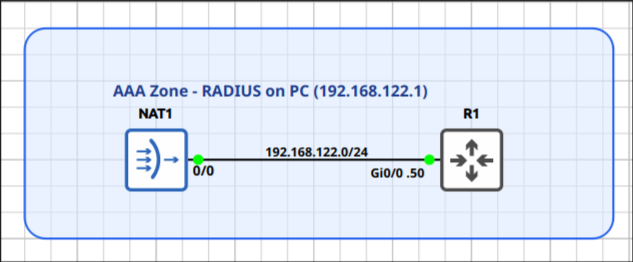
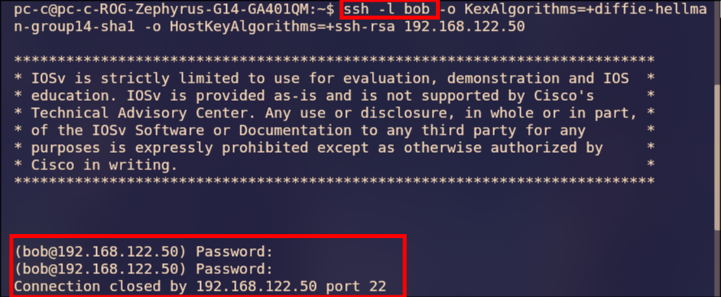
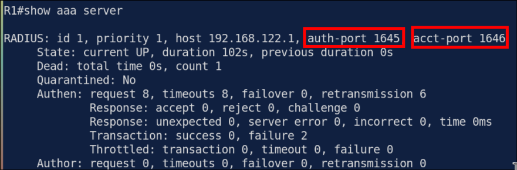
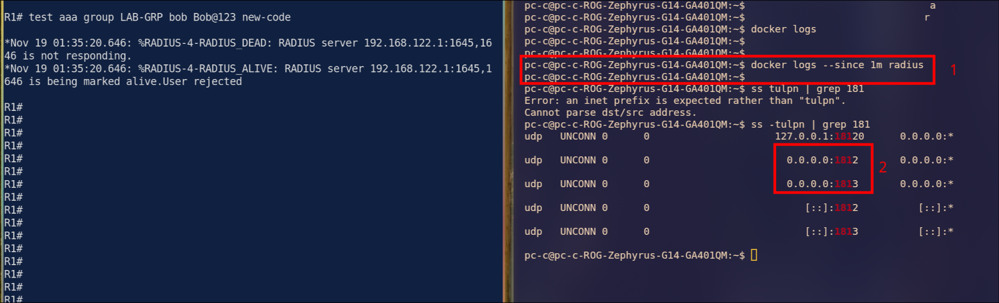
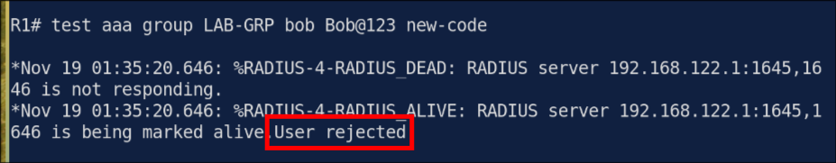
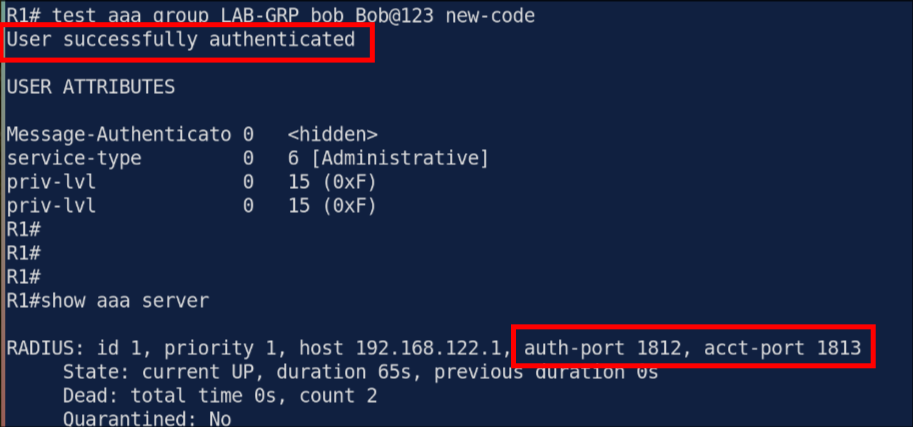
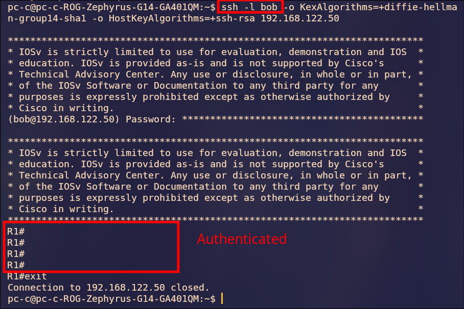

# Lab 2.1: RADIUS Login Fails (Wrong RADIUS Port)

> **GNS3 Project:** [`ENARSI Module 2 - AAA | Lab 1 - RADIUS Login Fails.gns3`](./ENARSI%20Module%202%20-%20AAA%20%7C%20Lab%201%20-%20RADIUS%20Login%20Fails.gns3)
> **Platform:** GNS3 3.1 · Cisco IOSv `15.9(3)M12` · 1 router (R1) · FreeRADIUS 3 in Docker on the host
> **Key takeaway:** A RADIUS server that never answers is a port, reachability or key problem, not a password problem. A wrong password gets an Access-Reject right away. IOS still defaults to the old ports 1645/1646.

---

## Topology & Addressing

| Device | Interface | Address | Role |
| :--- | :--- | :--- | :--- |
| **R1** | `Gi0/0` | 192.168.122.50/24 | SSH target, RADIUS client (NAS) |
| **NAT1** | `nat0` | 192.168.122.1/24 (virbr0) | Link to the host |
| **Host** | virbr0 | 192.168.122.1 | FreeRADIUS on UDP 1812/1813, secret `Radius@123` |

| User | Where | Password | Privilege |
| :--- | :--- | :--- | :---: |
| `bob` | RADIUS | `Bob@123` | 15 (`cisco-avpair = "shell:priv-lvl=15"`) |
| `admin` | R1 local | `Admin@123` | 15 (fallback) |

R1 uses `aaa authentication login default group LAB-GRP local`, so the local user is only tried when the RADIUS server doesn't answer.

---

## Fault-Injection (Break-It)

### Symptom
`bob` can't SSH into R1: `Authentication failed`. The local `admin` still gets in, but only after a long wait.

~~~
ssh -l bob -o KexAlgorithms=+diffie-hellman-group14-sha1 -o HostKeyAlgorithms=+ssh-rsa 192.168.122.50
~~~

### Diagnosis

1. **Is it slow because of no reply?** Yes. The long wait before the local login means R1 sent a request and got nothing back, so it waited for the timeout and fell back to `local`. A server that gets the request answers at once, even for a wrong password.

2. **Which port is R1 using?** `show aaa servers` shows `auth-port 1645, acct-port 1646`, the IOS defaults, because the `address` line has no ports.
   ~~~
   R1# show aaa servers
   R1# show run | section radius server
   ~~~
   

3. **Where does the server listen?** FreeRADIUS listens on 1812/1813, and its log shows no Access-Request from 192.168.122.50 at all.
   ~~~
   $ ss -ulnp | grep 1812
   $ docker logs radius
   ~~~
   

4. **Confirm without SSH.** `test aaa` fails the same way.
   ~~~
   R1# test aaa group LAB-GRP bob Bob@123 new-code
   ~~~
   

> **Why not test the port with `/dev/udp`?** UDP has no handshake, so sending to a closed UDP port still "succeeds". With RADIUS, the server log is the proof that a request arrived.

### Fix
Set the ports the server uses:
~~~
R1(config)# radius server LAB
R1(config-radius-server)# address ipv4 192.168.122.1 auth-port 1812 acct-port 1813
~~~

### Verification

| Test | Expected |
| :--- | :---: |
| `R1# show aaa servers` | `auth-port 1812, acct-port 1813`, `Response: accept` > 0 |
| `R1# test aaa group LAB-GRP bob Bob@123 new-code` | `User successfully authenticated`, `priv-lvl 15` |
| `docker logs radius` | `Sent Access-Accept ... to 192.168.122.50` |
| `ssh -l bob 192.168.122.50` | Lands at `R1#` |
| `ssh -l admin 192.168.122.50` | Fails at once: RADIUS sends `Access-Reject` for `admin` |

> **Note:** with RADIUS working, `admin` is no longer accepted, because `local` is only tried when the server is down. A reject is an answer, so there is no fallback.

---

## Troubleshooting Toolbox (IOS)

| Command | What it shows |
| :--- | :--- |
| `show aaa servers` | Server address, auth/acct ports, state, request and response counters |
| `test aaa group LAB-GRP bob Bob@123 new-code` | One RADIUS login test without SSH |
| `debug radius` / `undebug all` | Each Access-Request, retransmits and the reply (or timeout) |
| `docker logs radius` | What the server received and what it sent back |
